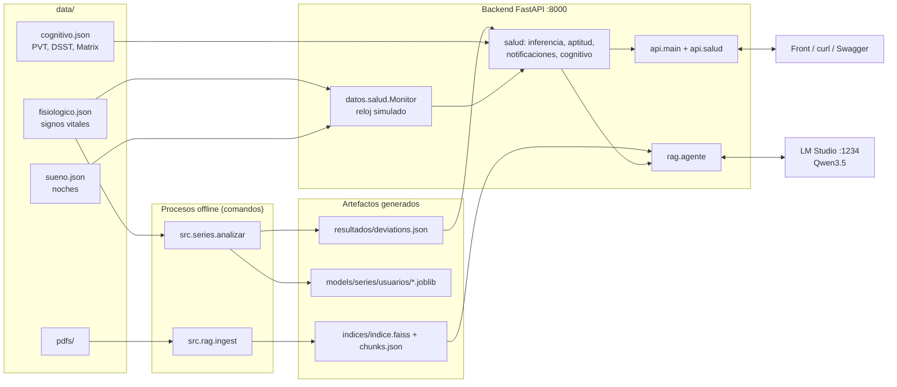
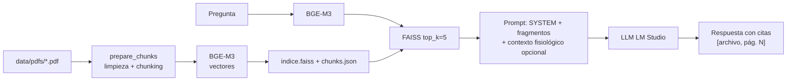
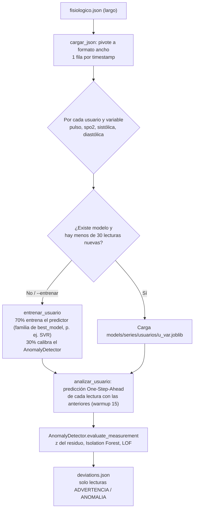
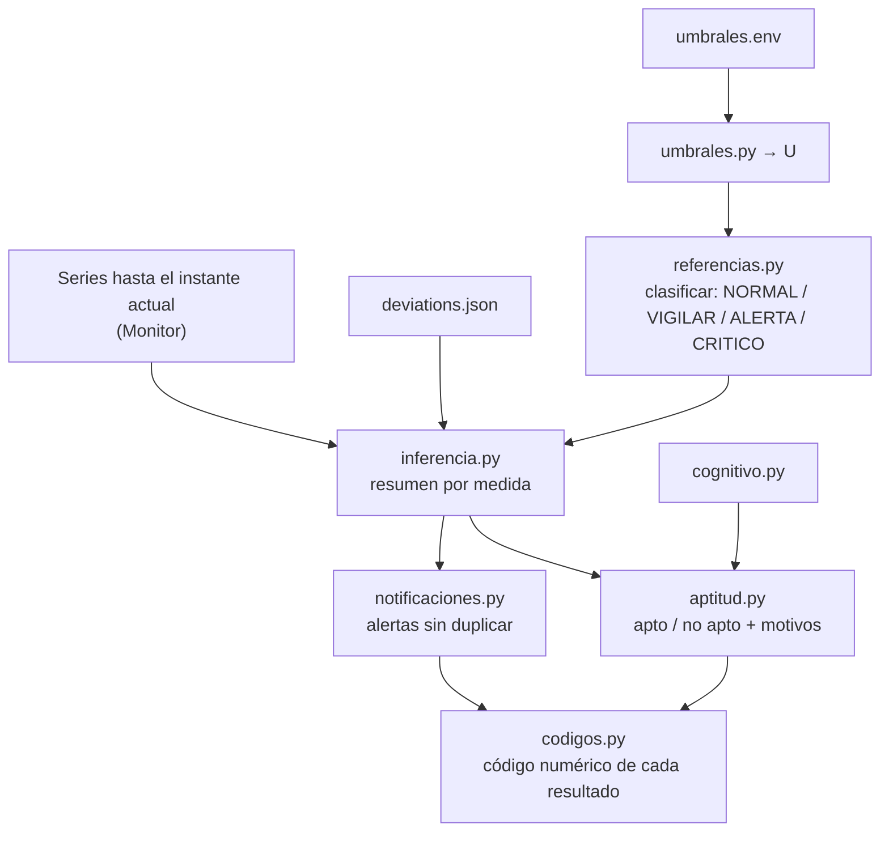
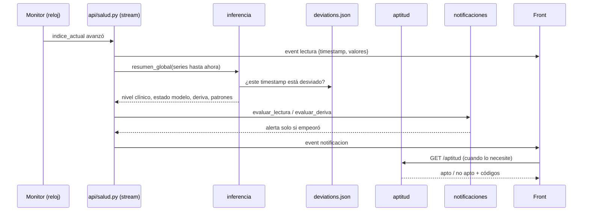

# Arquitectura integral: Space Challenge

Resumen completo del sistema de monitoreo de salud de astronautas: qué hace cada pieza, cómo se conectan, para qué sirve cada comando y cada documento.

> Orientativo, **no es diagnóstico médico**. Todo corre **local y sin internet** (salvo la descarga inicial de modelos).

---

## 1. Visión general

El proyecto tiene **cuatro bloques** que se juntan en un único backend FastAPI:

| Bloque | Qué resuelve | Código |
|---|---|---|
| **A. RAG (documentación)** | Responde preguntas técnicas citando los PDFs de la NASA | `src/rag/` |
| **B. Series de tiempo (ML)** | Entrena un modelo **por tripulante y por variable** y marca lecturas que se salen de *su* patrón | `src/series/` |
| **C. Motor de salud** | Combina límites clínicos + modelo personal + deriva + patrones → resumen, aptitud y notificaciones | `src/salud/` |
| **D. Datos y API** | Carga los datos, simula el "tiempo real" y expone todo por HTTP/SSE | `src/datos/`, `src/api/` |



**Dos procesos en ejecución:** el backend (`:8000`) y LM Studio (`:1234`). La parte de salud funciona aunque el LLM esté apagado.

---

## 2. Estructura de carpetas

```
Space-Challenge/
├── umbrales.env              # TODOS los umbrales clínicos/estadísticos (editable sin tocar código)
├── requirements.txt          # dependencias
├── README.md
├── data/
│   ├── fisiologico.json      # signos vitales (formato largo)
│   ├── fisiologico_copy.json # copia de prueba (SpO2 de astro_1 que cae hasta 89.5 %)
│   ├── sueno.json            # sueño por noche (generado por scripts/importar_sueno.py)
│   ├── cognitivo.json        # sesiones cognitivas (generado por scripts/simular_cognitivo.py o POST)
│   ├── pdfs/                 # documentación técnica para el RAG
│   ├── indices/              # salida de ingest: indice.faiss, chunks.json, report.md
│   └── resultados/           # deviations.json (modelo) y notificaciones.json (alertas)
├── models/
│   ├── bge-m3/               # embeddings del RAG
│   ├── chronos-2/            # modelo de series (experimental, no usado en el flujo actual)
│   └── series/
│       ├── best_model.joblib # pipeline global "ganador" (plantilla)
│       └── usuarios/         # <usuario>_<variable>.joblib: un modelo por persona y variable
├── scripts/                  # utilidades de una sola ejecución
├── src/
│   ├── config.py             # rutas y parámetros centrales
│   ├── api/                  # FastAPI (main, salud, sse)
│   ├── datos/                # carga y simulación (salud.py, cognitivo.py)
│   ├── rag/                  # prepare_chunks, ingest, agente
│   ├── salud/                # umbrales, referencias, inferencia, aptitud, notificaciones, cognitivo, codigos
│   └── series/               # analizar, features, models, anomaly_detection, json_generator
├── tests/test_salud.py       # pruebas automáticas (pytest)
└── docs/                     # documentación (ver §9)
```

---

## 3. Bloque A: RAG (consulta de documentación)

### Cómo funciona



| Archivo | Función |
|---|---|
| `src/rag/prepare_chunks.py` | Lee PDFs con `pypdf`; quita índices, encabezados/pies repetidos, ligaduras y errores OCR. Un chunk por requisito `[V1 xxxx]` en estándares NASA; en el resto, por secciones (máx. 400 tokens, solapamiento de 1 oración). Reglas por PDF en `PROFILES`. |
| `src/rag/ingest.py` | Ejecuta el chunking, genera embeddings con BGE-M3 y guarda `indice.faiss`, `chunks.json` y un `report.md` de calidad. |
| `src/rag/agente.py` | `buscar` (top-k en FAISS) → `preparar` (arma el prompt) → `generar` (stream de tokens) → `fuentes_de`. Además `estado_fisiologico()` convierte el resumen y la aptitud de un tripulante en texto para el LLM. |

**Decisiones clave:** la búsqueda es **siempre obligatoria** (no hay tool calling, poco fiable con modelos de 4-9B); un `threading.Lock` atiende una pregunta a la vez (CPU); si la pregunta trae `usuario`, el agente recibe datos **calculados** del motor de salud, no inventados.

---

## 4. Bloque B: series de tiempo (modelo personal)

### Cómo funciona `python -m src.series.analizar`



| Archivo | Función |
|---|---|
| `analizar.py` | Orquestador: carga, (re)entrena por usuario/variable, evalúa cada lectura y escribe `deviations.json`. |
| `features.py` | `FeatureEngineer`: lags, ventanas móviles y escalado de las variables de entrada. |
| `models.py` | Familias de predictores: Exponential Smoothing, ARIMA, Random Forest, Gradient Boosting, SVR, LSTM, GRU. |
| `anomaly_detection.py` | Clasifica el residuo (real − predicho): **ADVERTENCIA** si \|z\| ≥ `MODELO_Z_ADVERTENCIA` (2.0); **ANOMALIA** si \|z\| ≥ `MODELO_Z_ANOMALIA` (3.0), o ≥ 2.5 si Isolation Forest también la marca. |
| `json_generator.py` | Esquemas pydantic que validan la salida (`metadata`, `summary`, `deviations`). |

**Reentrenamiento automático:** cuando un usuario acumula `REENTRENAR_CADA` (30) lecturas nuevas; mínimo `MIN_ENTRENAMIENTO` (60) lecturas para entrenar.

> [!IMPORTANT]
> El modelo one-step-ahead "aprende" las caídas lentas: si la SpO2 baja 0.5 % por lectura, cada lectura se parece a la anterior y el modelo la ve normal. Por eso el motor de salud añade **límites clínicos** y **deriva lenta** (§5), que sí detectan ese caso.

---

## 5. Bloque C: motor de salud (`src/salud/`)

Une las tres fuentes de evidencia. **Regla de oro: el límite clínico manda**; el modelo personal nunca anula un valor peligroso.



| Archivo | Función |
|---|---|
| `umbrales.py` | Lee `umbrales.env` (o el archivo indicado en `UMBRALES_ENV`); las variables de entorno tienen prioridad; valores por defecto en `DEFAULTS`. Una clave inválida detiene el arranque. |
| `referencias.py` | Límites clínicos absolutos (`clasificar`) y magnitudes derivadas: presión de pulso, presión arterial media, índice de choque. |
| `inferencia.py` | Por cada variable: estadísticas, línea base (primeras 15 lecturas), z respecto a la base, tendencia (pendiente de las últimas 12), estado del modelo personal (busca el timestamp en `deviations.json`), **deriva lenta** (media reciente vs. línea base y vs. hace 36 lecturas) y **patrones** multivariable (respiratorio 5004, circulatorio 5007, choque 5008...). |
| `aptitud.py` | Decide **apto / no apto** (1001, 1002, 1010, 1011): crítico → no apto; alerta sostenida (3 lecturas) o alerta + modelo desviado → no apto; deriva + fuera de rango → no apto; patrón respiratorio → no apto. Lo cognitivo solo **observa**. |
| `notificaciones.py` | Emite una alerta solo cuando el nivel de una medida **empeora** (sin repetir); alerta de deriva con histéresis (`DERIVA_REARME_LECTURAS`). Guarda en `notificaciones.json`. |
| `cognitivo.py` | Compara PVT (tiempo de reacción, lapsos), DSST (throughput) y Matrix (correctas) con la línea base de la persona → niveles 8xxx y observaciones 5018-5020. |
| `codigos.py` | Catálogo de códigos para el front (familias 1xxx a 9xxx). |

### Familias de códigos

| Familia | Significado | Ejemplos |
|---|---|---|
| 1xxx | Estado general (aptitud) | 1001 saludable · 1002 apto con seguimiento · 1010 riesgo · 1011 crítico |
| 2xxx | Nivel clínico de una medida | 2001 normal · 2002 vigilar · 2010 alerta · 2011 crítico |
| 3xxx | Modelo personal | 3001 normal · 3002 advertencia · 3010 anomalía |
| 4xxx | Tendencia y deriva | 4003 descendente · 4110 deriva lenta |
| 5xxx | Hallazgos (motivos/observaciones) | 5001 límite crítico · 5004 patrón respiratorio · 5015 anomalía + fuera de rango |
| 6xxx | Notificaciones | 6001 vigilar · 6010 alerta · 6011 crítico · 6020 deriva |
| 7xxx | Chat | 7001 respuesta generada |
| 8xxx | Nivel cognitivo | 8001 normal · 8010 alerta |
| 9xxx | Errores | 9001 tripulante no existe · 9003 LLM no disponible |

---

## 6. Bloque D: datos y API

### Datos y simulación (`src/datos/`)

- **`salud.py` → `Monitor`**: carga `fisiologico.json` y `sueno.json`, los agrupa por tripulante y los reproduce como transmisión en vivo: `indice_actual = (ahora − t0) / SIM_SEGUNDOS_POR_LECTURA` (una lectura cada 2 s). Para un sensor real solo se reemplaza `indice_actual()` y la carga; la API no cambia.
- **`cognitivo.py` → `DatosCognitivo`**: valida (pydantic) y persiste sesiones en `cognitivo.json`. No se reproducen en el tiempo: se leen completas.

Formato de `fisiologico.json` (largo):

```json
{"usuario": "astro_1", "timestamp": "2026-11-01T00:00:00", "variable": "spo2", "valor": 97.8}
```

### Endpoints (`src/api/`)

| Método y ruta | Para qué |
|---|---|
| `GET /salud` | Estado del servicio y del LLM |
| `POST /preguntar` | Respuesta completa del RAG (opcional `usuario`, `variables`) |
| `POST /preguntar/stream` | Igual, en SSE: `fuentes` → `token`… → `fin` |
| `GET /tripulantes` | Lista de tripulantes y variables |
| `GET /tripulantes/codigos` | Catálogo de códigos |
| `GET /tripulantes/{id}/salud` | Foto actual + historial |
| `GET /tripulantes/{id}/salud/stream` | SSE en vivo: `snapshot`, `lectura`, `sueno`, `notificacion`, `fin` |
| `GET /tripulantes/{id}/resumen` | Resumen por medida, derivadas y patrones |
| `GET /tripulantes/{id}/aptitud` | Apto / no apto con motivos y recomendaciones |
| `GET /tripulantes/{id}/notificaciones?desde=N` | Alertas generadas |
| `POST /tripulantes/{id}/cognitivo` | Guarda una sesión cognitiva |
| `GET /tripulantes/{id}/cognitivo[/resumen]` | Historial y estado cognitivo |
| `POST /tripulantes/reiniciar-simulacion` | Reinicia el reloj simulado y las notificaciones |

`src/api/sse.py` da formato a los eventos Server-Sent Events. Swagger: http://localhost:8000/docs

---

## 7. Flujo de una lectura de principio a fin



---

## 8. Comandos: qué hace cada uno

Todos se ejecutan **desde la raíz del proyecto** con el entorno virtual activado.

### Instalación (una vez)

| Comando | Para qué |
|---|---|
| `python -m venv .venv` | Crea el entorno virtual |
| `.venv\Scripts\activate` (Windows) / `source .venv/bin/activate` | Lo activa |
| `pip install torch --index-url https://download.pytorch.org/whl/cpu` | PyTorch solo CPU (más ligero) |
| `pip install -r requirements.txt` | Resto de dependencias |
| `python scripts/descargar_modelos.py` | Descarga BGE-M3 y Chronos-2 a `models/`. **Único paso con internet** |

### Preparación de datos

| Comando | Para qué | Cuándo |
|---|---|---|
| `python scripts/importar_sueno.py` | Convierte la actigrafía de `data/sleep/` en `data/sueno.json` | Si cambian los datos de sueño |
| `python scripts/simular_cognitivo.py` | Genera sesiones cognitivas de demo en `data/cognitivo.json` | Para demos |
| `python -m src.rag.ingest` | Construye el índice FAISS a partir de `data/pdfs/` | Si cambian los PDFs o el chunking |
| `python -m src.rag.prepare_chunks --pdf-dir data/pdfs --out salida/` | Solo chunking, para revisar | Depuración |

### Modelo personal

| Comando | Para qué |
|---|---|
| `python -m src.series.analizar` | (Re)entrena cuando hace falta y genera `deviations.json` para todos |
| `python -m src.series.analizar --usuario astro_1` | Solo un tripulante |
| `python -m src.series.analizar --entrada data/fisiologico_copy.json` | Analiza otro archivo (pruebas) |
| `python -m src.series.analizar --entrenar` | Fuerza el reentrenamiento |

### Ejecución

| Comando | Para qué |
|---|---|
| `lms load qwen/qwen3.5-9b` y `lms server start` | Sirve el LLM en LM Studio (`:1234`) |
| `python -m src.rag.agente` | Chat por consola con el RAG |
| `python -m src.api.main` | Backend completo en `:8000` |
| `uvicorn src.api.main:app --host 127.0.0.1 --port 8000` | Alternativa con uvicorn |

### Pruebas y mantenimiento

| Comando | Para qué |
|---|---|
| `python -m pytest tests` | Pruebas automáticas del motor de salud (límites, deriva, aptitud, notificaciones, umbrales) |
| `python -c "import json; from src.api.main import app; json.dump(app.openapi(), open('docs/openapi.json','w'), ensure_ascii=False, indent=2)"` | Regenera el contrato OpenAPI tras cambiar endpoints |
| `curl localhost:8000/salud` | Comprueba que el backend está vivo |
| `curl -N localhost:8000/tripulantes/astro_1/salud/stream` | Ve el stream en vivo |

### Variables de entorno útiles

| Variable | Efecto | Ejemplo (PowerShell) |
|---|---|---|
| `DATOS_FISIOLOGICOS` | Archivo de signos vitales que leen la API y `analizar` | `$env:DATOS_FISIOLOGICOS="data/fisiologico_copy.json"` |
| `DATOS_SUENO` | Archivo de sueño | `$env:DATOS_SUENO="data/otro_sueno.json"` |
| `DATOS_COGNITIVO` | Archivo cognitivo | `$env:DATOS_COGNITIVO="data/otro_cog.json"` |
| `UMBRALES_ENV` | Archivo de umbrales alternativo | `$env:UMBRALES_ENV="umbrales_test.env"` |
| Cualquier clave de `umbrales.env` | Sobrescribe ese umbral | `$env:SPO2_ALERTA_MIN="94"` |

### Escenario de prueba: caída gradual de SpO2

```powershell
python -m src.series.analizar --entrada data/fisiologico_copy.json --usuario astro_1
$env:DATOS_FISIOLOGICOS = "data/fisiologico_copy.json"
python -m src.api.main
# Luego: GET /tripulantes/astro_1/aptitud  → hacia las 02:30 (SpO2 89.5 %) pasa a 1011 CRITICO
```

Resultado esperado: VIGILAR desde 94.6 %, ALERTA desde 91 % (notificación de hipoxemia), CRÍTICO + ANOMALIA (z ≈ −7.6) a 89.5 % con patrón respiratorio 5004 y **no apto**.

---

## 9. Documentos: para qué sirve cada uno

| Documento | Para quién | Contenido |
|---|---|---|
| `README.md` | Todos | Introducción, estructura e instalación |
| `docs/ARQUITECTURA.md` | Todos | Este documento: visión integral |
| `docs/CONTEXT.md` | Producto / equipo | Descripción del reto, objetivos e historias de usuario |
| `docs/BACKEND.md` | Backend | Arquitectura interna: RAG, simulación, sueño, cognitivo, configuración y decisiones de diseño |
| `docs/API.md` | Backend / Front | Referencia de cada endpoint y evento SSE con ejemplos |
| `docs/FRONT.md` | Front | Tipos TypeScript, helper SSE, manejo de errores, comportamiento de la UI y formato de sesión cognitiva (§9) |
| `docs/openapi.json` | Front (herramientas) | Contrato máquina-legible (generar clientes con `openapi-typescript`) |
| `docs/front/voz.ts` | Front | Lee en voz alta las respuestas del chat, las notificaciones y la aptitud con la Web Speech API del navegador (sin backend ni internet) |
| `docs/INFERENCIAS.md` | Médico / backend | Cada inferencia calculada (línea base, tendencia, deriva, patrones) y sus fórmulas |
| `docs/UMBRALES.md` | Médico / operación | Cómo editar `umbrales.env`, prioridad de variables de entorno y significado de cada clave |
| `docs/CODIGOS.md` | Front | Catálogo de códigos y dónde aparece cada uno |
| `docs/COGNITIVO.md` | Backend | Plan e integración del módulo cognitivo (línea base, z, persistencia, deriva) |
| `docs/PRUEBAS_COGNITIVAS.md` | Producto / médico | Qué mide cada prueba (PVT, DSST, Matrix) y para qué sirve |
| `data/indices/report.md` | Backend RAG | Calidad del chunking: páginas omitidas, chunks sospechosos, muestras |
| `umbrales.env` | Médico / operación | Valores de todos los umbrales; se cambian sin tocar código (reiniciar el backend) |

---

## 10. Configuración central (`src/config.py`)

| Parámetro | Defecto | Efecto |
|---|---|---|
| `TOP_K` | 5 | Fragmentos que recibe el LLM |
| `MAX_TOKENS` / `MIN_TOKENS` / `OVERLAP_ORACIONES` | 400 / 60 / 1 | Chunking (requiere volver a ejecutar `ingest`) |
| `LMSTUDIO_URL` / `MODELO_LLM` | `:1234/v1` / `None` | Servidor y modelo del LLM (`None` = el primero cargado) |
| `TEMPERATURA` / `RAZONAMIENTO` / `MAX_TOKENS_RESPUESTA` | 0.2 / `"none"` / 300 | Generación |
| `MIN_ENTRENAMIENTO` / `REENTRENAR_CADA` | 60 / 30 | Entrenamiento del modelo personal |
| `API_HOST` / `API_PORT` / `CORS_ORIGENES` | `127.0.0.1` / 8000 / localhost | Backend |
| `SIM_SEGUNDOS_POR_LECTURA` | 2.0 | Velocidad de la simulación |

---

## 11. Limitaciones conocidas

- Datos **simulados** (un día grabado); falta la integración con sensores reales.
- El LLM en CPU tiene alta latencia (más de 1 min hasta el primer token con el modelo 9B).
- El modelo one-step-ahead no detecta por sí solo las caídas graduales; dependen de los límites clínicos y la deriva.
- Sin autenticación: no exponer con `API_HOST="0.0.0.0"` en redes no confiables.
- `chronos-2` está descargado pero no se usa en el flujo actual (el ganador es un modelo de `models.py`).
